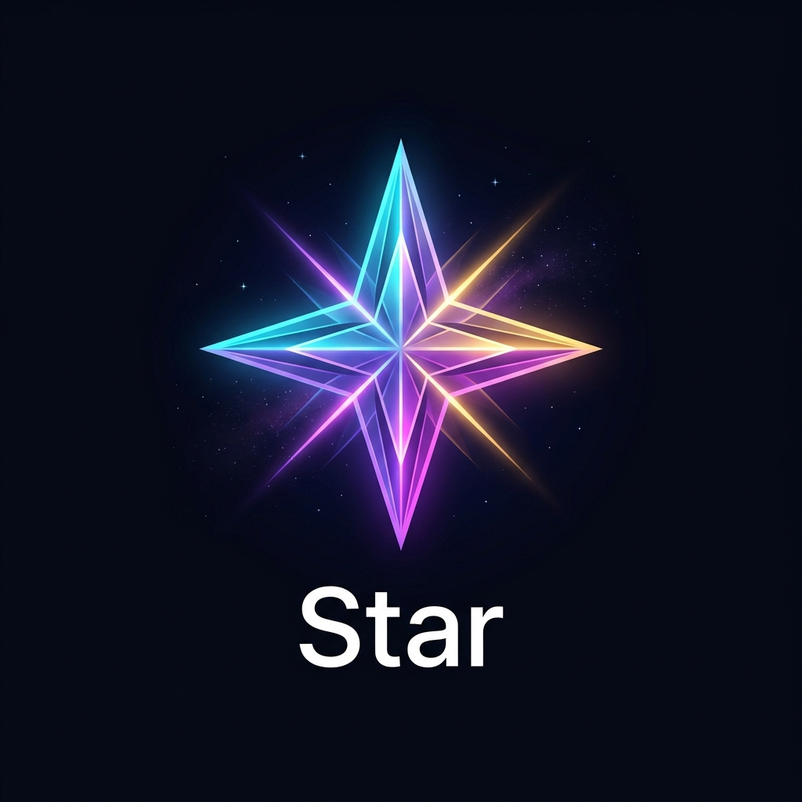

# ⭐ Star Programming Language for Visual Studio Code

Official Visual Studio Code extension for the **Star Programming Language** (`.star`, `.starb`, `.starmobile`).

## ✨ Features

- **🎨 Full Syntax Highlighting**: Comprehensive TextMate grammar covering Haven natural syntax (`whenever`, `otherwise`, `give back`, `remember`), Flutter declarative UI widgets (`Scaffold`, `AppBar`, `Container`, `When`), classes, modules, and operators.
- **⚡ Real-Time Diagnostics (Star Doctor)**: Automatic linting, syntax checking, and unused variable warnings on save and open with exact line/column indicators in VS Code's Problems panel.
- **📱 Flutter Declarative UI Preview (TUI)**: One-click terminal preview of Star declarative UI components directly inside VS Code (`Shift+F5`).
- **💡 Rich Code Snippets**: Pre-built snippets for complete applications (`star-app`), scaffolds (`star-scaffold`), 3D parallax cards (`star-hero-card`), Google Play Billing (`star-billing`), and Android WallpaperManager (`star-wallpaper`).
- **📖 Instant Hover Documentation**: Rich Markdown documentation on hover for Star keywords, Flutter widgets, and native Android/mobile APIs.
- **🚀 One-Click Execution & Build**:
  - Run active file (`F5`)
  - Preview UI (`Shift+F5`)
  - Compile to Bytecode `.starb`
  - Build Android APK (`star build apk`)
  - Deploy to Connected Device (`star deploy android`)
- **💬 Interactive REPL**: Built-in interactive Star REPL terminal.
- **✨ Document Formatting**: Auto-formatting support for Star code.

---

## ⌨️ Keyboard Shortcuts

| Shortcut | Command | Description |
| :--- | :--- | :--- |
| `F5` | `star.run` | Run active `.star` file |
| `Shift + F5` | `star.preview` | Preview UI in Terminal (TUI) |
| `Ctrl + Shift + C` | `star.check` | Run Star Doctor diagnostics |

---

## 🧩 Included Snippets

| Prefix | Snippet Name | Description |
| :--- | :--- | :--- |
| `star-app` | Star Universal App | Scaffolds a full Flutter/Material 3 Star application |
| `star-scaffold` | Flutter Scaffold | Declarative Scaffold widget with AppBar and FAB |
| `star-hero-card` | 3D Parallax Hero Card | Multi-depth layered touch-interactive card |
| `star-billing` | Google Play Billing | In-app purchase & subscription client integration |
| `star-wallpaper` | Android Wallpaper Bridge | Sets system, lock screen, or both wallpapers |
| `star-gyro` | Gyroscope Sensor | Computes 3D parallax offsets from device tilt |
| `star-whenever` | Whenever / Otherwise | Natural conditional branching |
| `star-when` | When Widget | Functional conditional widget `When(cond, a, b)` |
| `star-class` | Class Declaration | Class with properties and methods |
| `star-func` | Function Declaration | Idiomatic function with `give back` |

---

## ⚙️ Extension Settings

- `star.executablePath`: Custom path to `star.bat` or `star.exe` (defaults to auto-discovery).
- `star.lint.enable`: Enable real-time syntax checking via Star Doctor (default: `true`).
- `star.format.enable`: Enable automatic document formatting (default: `true`).

---

## 📄 License

Licensed under the MIT License. Copyright © 2026 Star Language Open Source Project.

